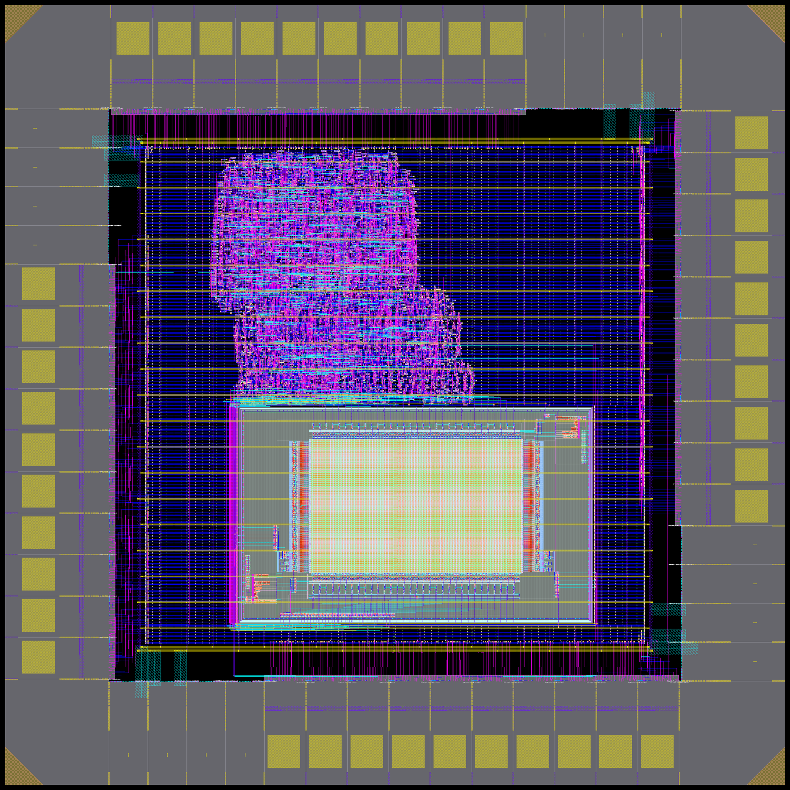

# PicoRV32 with Pad Ring, RTL to GDS (SKY130)

RTL-to-GDS flow for `picorv32_top`: a PicoRV32 RV32I core, a 2 KB OpenRAM
SRAM macro (`sky130_sram_2kbyte_1rw1r_32x512_8`) and a `sky130_ef_io` pad ring
(40 gpio pads + vdd/vss/vddio/vssio supply pads on each of the four sides),
targeting the open **SKY130** PDK. Orchestrated end-to-end with `make`, using
`igny` (Crucible) to provide every EDA tool as a reproducible, versioned
binding. Derived from the APB RTL-to-GDS flow in the sibling repo.

<p align="center">
  
</p>
<p align="center"><em>Final layout (GDS) of <code>picorv32_top</code>: 1504 x 1504 um die with the sky130_ef_io pad ring, the PicoRV32 standard cells, the 2 KB SRAM macro (bottom) and the PDN.</em></p>

## Design

| Item | Value |
|---|---|
| Top | `picorv32_top` (`01_rtl/picorv32_top.v`: core, `la_spram`, `la_padring`) |
| Clock | `clk` pad, 50 MHz (20 ns) |
| Reset | `resetn` pad (active low) |
| Outputs | `trap`, `mem_valid`, `mem_la_read`, `mem_la_write`, `mem_la_wstrb[3:0]`, `mem_addr[29:0]` (word address) |
| Supplies | `vdd`/`vss` (core), `vddio`/`vssio` (IO), one pad of each per side |
| Memory | program and data live in the on-die SRAM; the bus is also brought out on pads for observation |
| Die | 1504 x 1504 um, core 270..1234 um, pad cells butted so the ring buses connect by abutment |

Pad placement and cell orientation are computed in
`06_floorplanning/openroad_floorplan.tcl` from the instance names
(`padring.i<side>.ipad[n]`), so the ring order follows the CELLMAP in the RTL.

## ASIC results

Post-route numbers for this flow (SKY130 HD, TT 025C 1.80 V, 50 MHz target).
Sources: `04_synthesis/synth.log`, `final_output/reports/` and an OpenROAD
report on `09_place_and_route/route.odb`. "Gate equivalents" = std-cell area
(excluding tap/fill/pads/SRAM) / 3.75 um² (one NAND2_1).

| Metric | Value |
|---|---|
| Die size | 1504 x 1504 um (2.262 mm²) |
| Core size | ~964 x 960 um (0.925 mm²) |
| Std-cell area (post-route, logic + clock/repair buffers) | 82,728 um² |
| Synthesis area (logic only) | 76,851 um² (56 % sequential) |
| SRAM macro area (2 KB OpenRAM) | 284,538 um² |
| Pad area (40 gpio + 16 supply + 4 corner) | 1,075,846 um² |
| Std-cell instances (logic, excl. tap/fill) | 7,426 |
| Logic gates (combinational + inverters) | 5,356 + 140 inverters |
| Flip-flops | 1,543 (318 `dfxtp_1` + 1,225 `edfxtp_1`) |
| Gate equivalents (NAND2) | ~22 k |
| Clock buffers / timing-repair buffers | 190 (+15 clk inverters) / 197 |
| Macros / IO pads | 1 SRAM / 40 gpio + 16 supply |
| Target clock | 50 MHz (20 ns) |
| Fmax (post-route estimate) | ~112 MHz (min period 8.92 ns) |
| Setup / hold WNS (TT) | 0.00 (met); worst setup slack 7.66 ns, worst hold slack 0.43 ns |
| Setup / hold WNS (SS 100C 1.60 V) | 0.00 (met); worst setup slack 5.51 ns, worst hold slack 0.86 ns |
| Power, total (default activity) | 16.2 mW (SRAM macro 16.0 mW, std cells 0.15 mW) |
| Static IR drop (vdd / vss worst) | 0.64 mV (0.04 %) / 1.87 mV (0.10 %) |
| Route DRC (TritonRoute) | 0 violations |
| Magic DRC | 0 errors |
| LVS (core logic, pads/SRAM blackboxed) | see `final_output/reports/netgen_lvs.log` |

### Comparison with the SiliconCompiler padring run

Compared against the SiliconCompiler `padring` project
(`build/padring/job0/write.views/0/reports/`, `metrics.json`) for the same
`picorv32_top`. Both runs end with the same 1,543 flip-flops; the differences
come from die size, what is counted, and how power/timing were set up.

| Metric | This flow (OpenROAD + Crucible) | SiliconCompiler padring | Note |
|---|---|---|---|
| Die size | 1504 x 1504 um (2.262 mm²) | 1900 x 1900 um (3.61 mm²) | this flow is ~37 % smaller |
| Core area | 0.925 mm² | 1.956 mm² | |
| Std-cell instances (excl. tap/fill) | 7,426 | 7,592 (1,543 seq + 5,538 comb + 216 inv + 295 buffers) | |
| Flip-flops | 1,543 | 1,543 | identical |
| Combinational cells | 5,356 | 5,538 | |
| Std-cell logic area | 82,728 um² | 80,144 um² | |
| Gate equivalents (NAND2) | ~22.0 k | ~21.4 k | |
| Timing-repair buffers | 197 (+190 clock buffers) | 295 | |
| Tap cells | 8,338 | 22,130 | SC taps are denser |
| Fill cells | 1,018 | 193,916 | SC inserts filler across the whole core |
| Total instances | 16,843 | 223,963 | mostly SC fill |
| SRAM macro | 1 x 284,538 um² | 1 x 284,538 um² | same macro |
| gpio / supply pads | 40 / 16 | 40 / 16 | same |
| Pad spacers (bus slices) | not instantiated (pads abut) | 208 | |
| Corner cells | 4 | 4 | |
| Core utilization (instances / die) | 41 % | 28 % (std-cell only: 16 %) | |
| Clock | 50 MHz | 100 MHz field in metrics | |
| Setup / hold WNS | met (7.66 / 0.43 ns worst slack) | not meaningful: ws = 1e39, 2,858 unconstrained endpoints | SC run has no real clock constraint on the pads |
| Fmax | ~112 MHz | 100 MHz (constraint value) | |
| Total power | 16.2 mW | 0.47 mW | SC models the SRAM at near-zero activity |
| Static IR drop, vdd worst | 0.64 mV (1.80 V supply) | 0.14 mV (1.95 V supply) | |
| Static IR drop, vss worst | 1.87 mV | 0.18 mV | |
| DRV violations | 0 route DRC | slew 6, cap 6, 4 floating nets, 4 overdriven nets (per metrics.json) | |
| Flow errors | 0 | 0 (8 warnings) | |

The power and IR numbers are not like for like: this flow uses OpenROAD's
default activity and a 1.80 V supply, while the SiliconCompiler run reports a
1.95 V supply and a much lower activity, so the SRAM contributes almost nothing.
Treat the cell counts and area as the meaningful comparison.

## Flow stages

Each stage is a numbered directory with its own `Makefile`, driven from the
top-level `Makefile`:

| Stage | Directory | Tool(s) | Purpose |
|---|---|---|---|
| 1 | `00_lint` | `verilator` | RTL lint |
| 2 | `01_rtl` | — | RTL (`picorv32_top.v`) and the SRAM behavioural model (`models/`) |
| 3 | `02_sim` | `iverilog` | Functional simulation with pad and SRAM models |
| 4 | `03_verification` | `iverilog` | Self-checking regression (re-runs `02_sim`) |
| 5 | `04_synthesis` | `yosys` | Logic synthesis against the SKY130 lib |
| 6 | `05_dft` | — | Design-for-test |
| 7 | `06_floorplanning` | `openroad` | Floorplan |
| 8 | `07_placement` | `openroad` | Placement |
| 9 | `08_sta` | `openroad` | Static timing analysis (std cells + pad + SRAM libs) |
| 10 | `09_place_and_route` | `openroad` | CTS + routing |
| 11 | `10_gds` | `klayout-stream` | GDS streamout |
| 12 | `11_physical_verification` | `python`, `openroad`, `magic`, `netgen` | vdd/vss short check, static IR drop, DRC, extraction, LVS (pads and SRAM blackboxed) |

## Running the flow

All commands run through `igny` inside the `picorv32_ignytion` Crucible environment
bound to this workspace (`crucible.toml`).

```bash
igny run make            # full flow: lint → sim → verify → synth → floorplan → place → cts → route → sta → gds → physical → final
igny run make lint       # 00_lint only
igny run make sim        # 02_sim only
igny run make verify     # 03_verification only
igny run make synth      # 04_synthesis only
igny run make dft        # 05_dft only
igny run make floorplan  # 06_floorplanning only
igny run make place      # 07_placement only
igny run make cts        # 09_place_and_route cts
igny run make route      # 09_place_and_route route
igny run make sta        # 08_sta only
igny run make gds        # 10_gds only
igny run make physical   # 11_physical_verification only (includes the static IR drop)
igny run make final      # collect deliverables and reports into final_output/
igny run make clean      # remove generated artifacts across all stages, including final_output/
```

## Reproducing the toolchain

Run `igny workspace lock` once to generate `crucible.lock` for this workspace (not copied from the APB repo). On another machine:

```bash
igny workspace sync   # installs + binds every tool in crucible.lock
igny status            # confirm environment + tool count
```

## Notes

### How the pad ring, corner cells and SRAM were added

**The design in two lines:** `picorv32_top` wraps a PicoRV32 RV32I core with a
2 KB OpenRAM SRAM that holds the program and data. A `sky130_ef_io` pad ring
(40 gpio + supply pads) surrounds it so the chip is fully padded out.

The standard `sky130_fd_sc_hd` flow knows nothing about IO pads, corners or
SRAM macros, so they are brought in by hand from the PDK's separate
`sky130_fd_io` and `sky130_sram_macros` libraries:

- **Pads:** the gpio and supply pads (`gpiov2_pad_wrapped`, `vccd/vssd/vddio/vssio_hvc_pad`) are instantiated in
  the RTL by the `la_padring` wrapper. They stay blackboxes in Yosys
  (`sky130_ef_io.v` read with `-lib`) and are placed from `sky130_ef_io.lef` in the floorplan.
  Positions and orientations are derived from the instance names, and the
  pads butt together so the ring buses connect by abutment.
- **Corner cells:** `sky130_ef_io__corner_pad` is physical-only and is not in
  the netlist, so `openroad_floorplan.tcl` creates the four corners directly in
  OpenDB (`odb::dbInst_create`) at the die corners with the right rotations.
- **SRAM:** `sky130_sram_2kbyte_1rw1r_32x512_8` is instantiated by `la_spram`,
  read as a blackbox in synthesis, fixed in the lower half of the core, and
  given its own `define_pdn_grid -macro` so its met4 supply pins join the met5 straps.
- **Libraries and views:** the pad/SRAM `.lib` files (`pdk_libs.tcl`) are loaded
  for STA, their LEF in the floorplan, and their GDS in `10_gds`
  (`sky130_ef_io.gds`, `sky130_ef_io__gpiov2_pad_wrapped.gds`, SRAM GDS) for
  stream-out. Simulation uses the PDK Verilog models with `-DFUNCTIONAL
  -DUSE_POWER_PINS`; LVS treats pads and SRAM as black boxes.

- The image above is a 2048 px copy of `final_output/images/picorv32_top.png`, which
  `make final` renders (8192 px) from `10_gds/picorv32_top.gds`; refresh it with
  `cp final_output/images/picorv32_top_preview.png docs/images/picorv32_top.png`.

- `make lint` writes `00_lint/lint_report.txt` and `make synth` writes
  `04_synthesis/synth.log`; both are copied into `final_output/reports/`.
- `make physical` runs, in order: the vdd/vss geometry short check
  (`scripts/check_pg_overlap.py`), static IR drop with the supplies placed at
  the real pad stubs (`run_ir_drop.sh`), Magic DRC + extraction, and Netgen LVS.
  Magic's per-cell `.ext` files go to `11_physical_verification/results/extract/`.
- Simulation needs the power-pinned functional pad models: the stage passes
  `-DFUNCTIONAL -DUSE_POWER_PINS` and the bench forces the shared `ioring`
  rails (see `02_sim/tb_picorv32_top.v`).
- `01_rtl/models/sky130_sram_2kbyte_1rw1r_32x512_8.v` is the PDK model with a
  `timescale` added and the `mem` declaration moved ahead of first use so
  iverilog accepts it.
- Synthesis keeps the pad cells and SRAM as blackboxes; OpenROAD places them
  from the PDK LEFs. Pad-only nets (`ioring[*]`, pad `PAD` nets) are marked
  special so global routing skips them.
- The vdd/vss pads are tied to the core PDN ring by met3 stubs plus via
  stacks added in the floorplan script (vias only where the ring runs).
- OpenROAD's resizer excludes the `probe`, `probec` and `lpflow` cells.
- LVS compares the core logic; pads and the SRAM are black boxes, and supplies
  are stripped. Power connectivity is covered by the geometry check and
  `check_power_connectivity.tcl`.


## Licensing and third-party material

There is no repository-wide licence file yet. Parts that carry their own terms:

- `01_rtl/picorv32_top.v` includes the PicoRV32 core, copyright Claire Xenia Wolf,
  ISC licence (the notice is kept at the top of the file), plus the Lambda
  project's `la_*` pad-ring and memory wrappers (MIT).
- `04_synthesis/lib/*.lib` and `01_rtl/models/sky130_sram_*.v` come from the
  SkyWater SKY130 PDK and the OpenRAM macro (Apache-2.0).
- Many flow files carry the "Copyright (c) 2026 Ignytion IO" header they had in
  the APB flow they were derived from.
